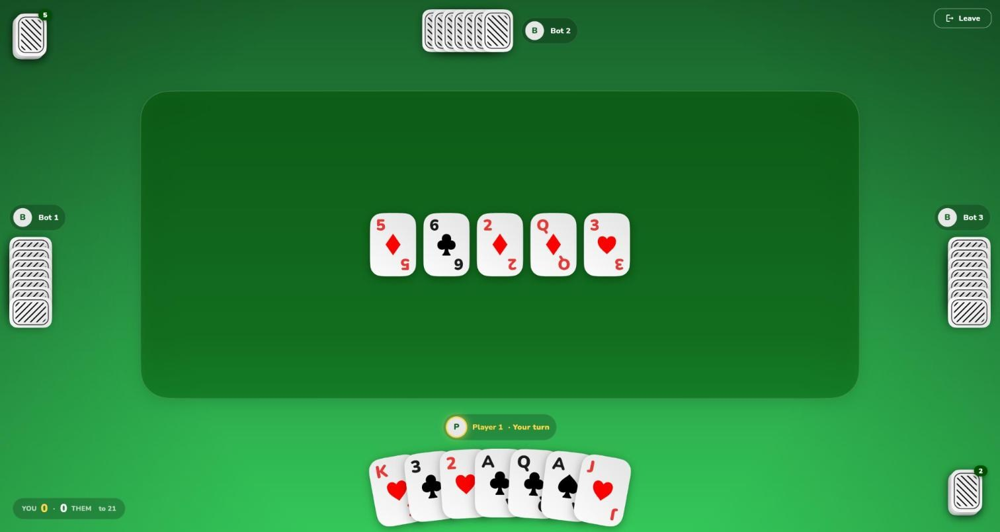

# Scopone

An online, real-time game of **Scopone**, the 4-player (2 vs 2) variant of the Italian card game Scopa. It is built with Flutter for the web and backed by Firebase.

Play it at **https://scopa-4c3c2.web.app**.



## Features

* **Google sign-in:** Create a public or private game, and join games with a code
* **Hidden hands:** Each player's hand is only readable by them, which is enforced by the Firestore security rules.
* **Choice of capture:** When more than one capture is possible, you can pick which one to make.
* **Scoring:** scope, cards, denari, settebello, primiera and napula, played as a match to 21.
* **Rejoin after a refresh,** plus a global leaderboard.

## House rules

* An Ace sweeps the whole board, but that doesn't count as a scopa.
* If you can capture either a single card or a sum, the single card must be taken.
* The last play of a hand never scores a scopa.

## Development

```bash
flutter pub get
flutter analyze
flutter test

# Run locally against the Firebase emulators; new games are filled with bots
firebase emulators:start --only auth,firestore
flutter run -d chrome --dart-define=TESTING=true   # add ?player=2 etc. for more seats
```

Pushes to `main` are built and deployed to Firebase Hosting by GitHub Actions. Firestore rules and indexes are deployed by hand with `firebase deploy --only firestore`.

